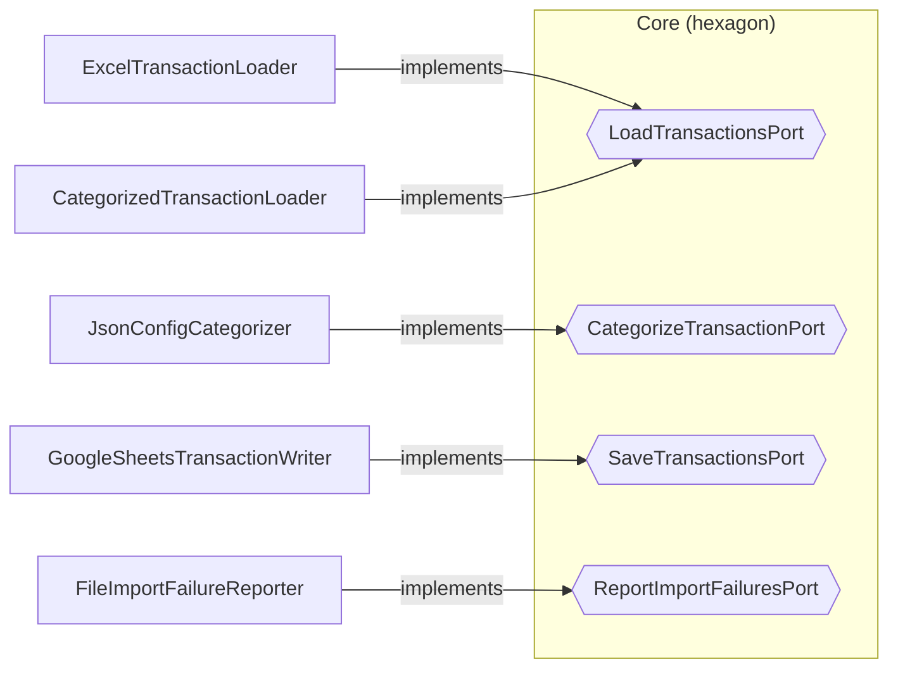

# Calcifer

Personal finance transaction manager. Parses a home banking Excel export, categorizes transactions with user-defined JSON rules, prints monthly category reports, and uploads all transactions to Google Sheets.

## Features

- **Monthly category report**: previous and current calendar month, grouped by category, with totals.
- **Google Sheets upload**: clears and rewrites the sheet with Italian dates (dd/mm/yyyy) and EUR accounting amounts.
- **JSON categorization**: case-insensitive keyword rules matched on description and details, then on the bank category, defaulting to `Others`.

## Requirements

- Node.js 20.15.0 (see `.nvmrc`)
- A Google Cloud service account with Sheets API access, saved as `service-account.json` (gitignored)
- The target spreadsheet shared with the service account email (Editor)

## Setup

```bash
npm install
```

Create `categorization-rules.json` in the project root (gitignored):

```json
[
  { "keywords": ["example-grocer", "example-grocer", "example-grocer"], "category": "Grocery" },
  { "keywords": ["example-streaming", "example-streaming"], "category": "Recurring Payments" }
]
```

Place the bank export at `input-files/export.xlsx` (gitignored).

## Usage

```bash
npm start
CATEGORIZATION_RULES_PATH=/path/to/rules.json npm start
```

Output:

1. Two monthly reports on stdout
2. Transactions uploaded to Google Sheets
3. Parse errors written to `import-failures.txt` (if any)

## Development

```bash
npm test              # run all tests
npm run test:watch    # watch mode
npm run lint          # type-check only
npm run build         # compile to dist/
```

## Architecture

Hexagonal architecture (ports & adapters). The core has no infrastructure dependencies; adapters implement ports defined by the core.



Directory layout:

```
src/
  core/
    domain/model/       Transaction, CategorySummary, ImportFailure
    domain/ports/       Port interfaces
    application/        Services (stateless, constructor injection)
  infrastructure/
    adapters/in/        Inbound adapters (none yet)
    adapters/out/       Outbound adapters
  main.ts               Composition root
tests/
  acceptance/           Outside-in tests with in-memory adapters
```

Wiring lives in `src/main.ts`. The `CategorizedTransactionLoader` decorator wraps the Excel loader, so services receive categorized transactions without knowing about categorization.

## Testing

- **Acceptance tests** (`tests/acceptance/`): full use cases through in-memory adapters.
- **Unit tests** (colocated `*.test.ts`): services and adapters in isolation, with ports mocked via `testdouble`.

## Conventions

- Outside-in TDD: acceptance test first, then use case, ports, adapters.
- Small, atomic commits; each must pass tests and type-check.
- See `AGENTS.md` and `.github/copilot-instructions.md` for details.
